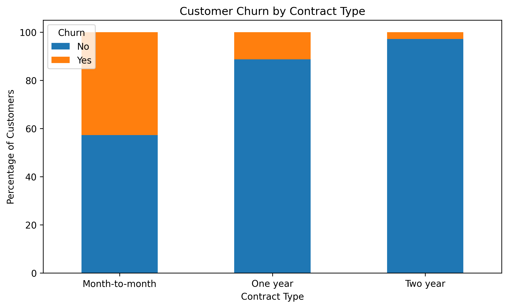
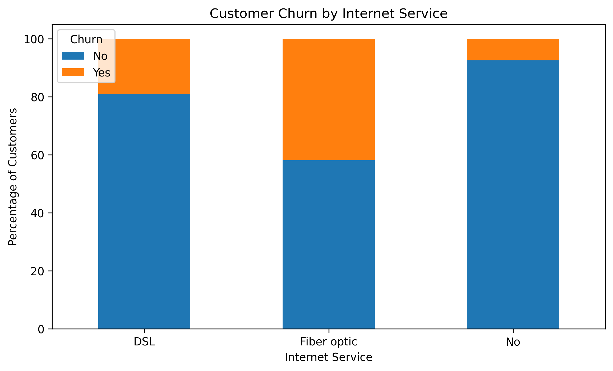
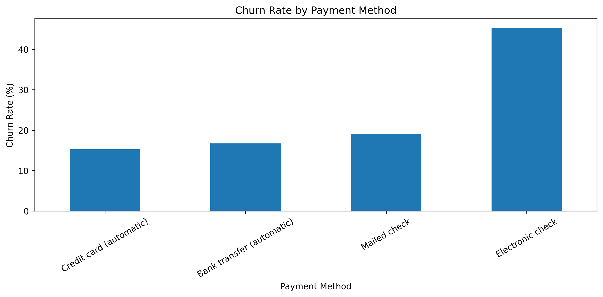
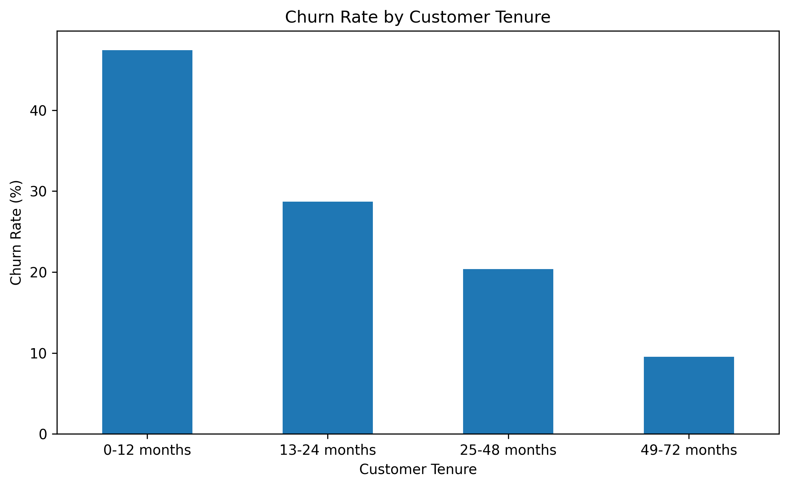
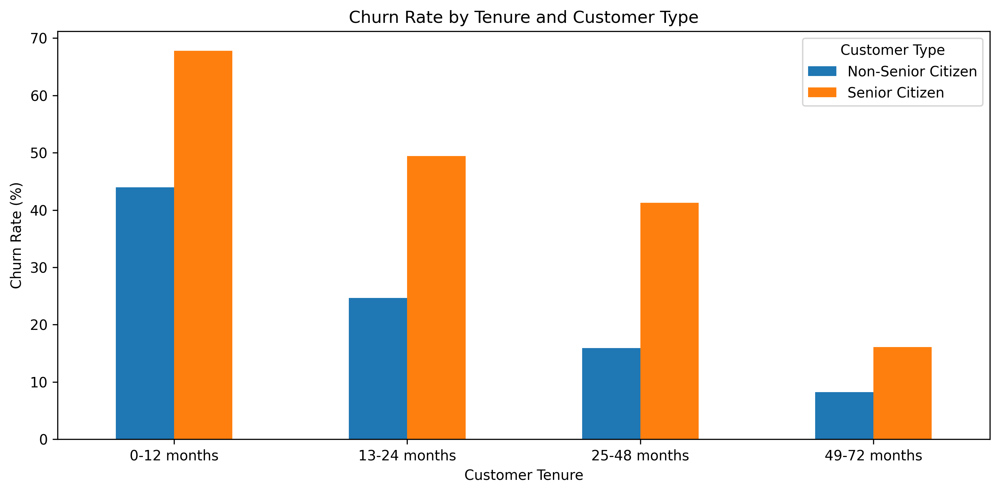
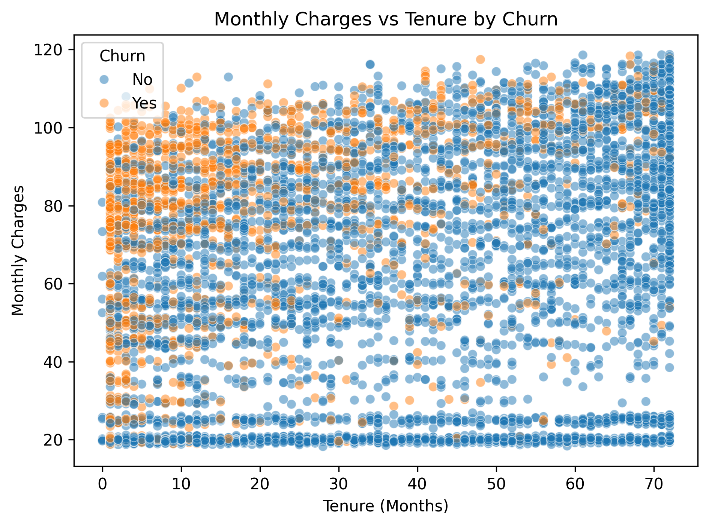
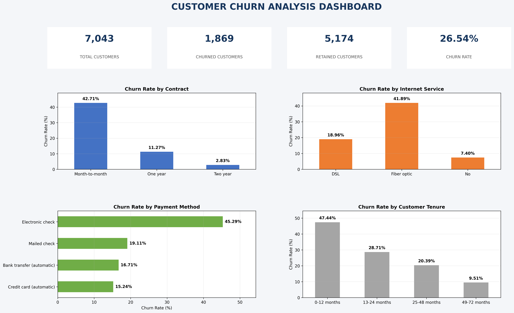

# Customer Churn Analysis

## Project Overview

Customer churn occurs when customers stop using a company's products or services. Understanding customer churn helps businesses identify at-risk customers and develop effective retention strategies.

This independent data analytics project explores customer churn patterns using the IBM Telco Customer Churn dataset.

## Business Problem

The objective is to identify customer characteristics and service patterns associated with higher churn rates and provide data-driven recommendations to improve customer retention.

## Project Objectives

- Analyze overall customer churn.
- Identify customer segments with high churn rates.
- Explore the relationship between contract type, internet service, payment method, and churn.
- Understand how customer tenure and monthly charges relate to churn.
- Recommend strategies to improve customer retention.

## Tools and Technologies

- Python
- Pandas
- NumPy
- Matplotlib
- Seaborn
- Jupyter Notebook
- Google BigQuery (SQL)

## Dataset

- Source: IBM Telco Customer Churn dataset
- Total records: 7,043 customers
- Original columns: 21
- Target variable: `Churn`

## Key Findings

- Overall customer churn rate: **26.54%**
- Month-to-month contract customers had the highest churn rate: **42.71%**.
- Customers with 0–12 months of tenure had a churn rate of **47.44%**.
- Customers with 49–72 months of tenure had a churn rate of **9.51%**.
- Electronic check users had the highest churn percentage among payment methods.
- Fiber optic customers had the highest churn percentage among internet service categories.
- Average monthly charges were higher among churned customers ($74.44) than customers who stayed ($61.27).

  
## SQL Analysis

Performed SQL-based customer churn analysis using Google BigQuery.

Key techniques:
- Data exploration and aggregation
- GROUP BY and HAVING
- CASE WHEN and CTEs
- Window functions (RANK, DENSE_RANK, ROW_NUMBER, LAG, LEAD)
- INNER, LEFT, RIGHT and FULL OUTER JOIN
- Subqueries and correlated subqueries

SQL analysis file: [customer_churn_analysis.sql](sql/customer_churn_analysis.sql)


## High-Risk Customer Segment

A combined analysis identified customers with the following characteristics:

- Month-to-month contract
- Fiber optic internet service
- Electronic check payment method

Results:

- Total customers: **1,307**
- Churned customers: **789**
- Churn rate: **60.37%**

This segment represents an important opportunity for targeted customer retention efforts.

## Visualizations

### 1. Churn by Contract Type


### 2. Churn by Internet Service


### 3. Churn by Payment Method


### 4. Churn by Customer Tenure


### 5. Tenure and Customer Type


### 6. Monthly Charges vs Tenure by Churn


## 📊 Customer Churn Analysis Dashboard

The dashboard provides an overview of customer churn patterns,
including key performance indicators and churn rates across
different customer segments.



### Key Metrics

- Total Customers: 7,043
- Churned Customers: 1,869
- Retained Customers: 5,174
- Overall Churn Rate: 26.54%

## Business Recommendations

1. Improve onboarding and support for new customers.
2. Introduce suitable loyalty benefits to encourage longer-term contracts.
3. Investigate fiber optic service quality, pricing, and customer complaints.
4. Simplify payment processes and provide alternative payment options.
5. Offer accessible customer support and guidance for senior customers.
6. Develop targeted retention campaigns for high-risk customer segments.

## Project Structure

```text
Customer-Churn-Analysis/
│
├── data/
├── images/
├── notebook/
│   └── customer_churn_analysis.ipynb
├── reports/
│   └── Customer_Churn_Analysis_Report.md
└── README.md
```

## Project Report

For the detailed analysis, findings, visualizations, and recommendations, see:

[Customer Churn Analysis Report](reports/Customer_Churn_Analysis_Report.md)

## Conclusion

This project demonstrates how exploratory data analysis can help identify customer churn patterns, uncover high-risk segments, and support business decisions through actionable insights.

**Project Type:** Independent / Self-Initiated Data Analytics Project
