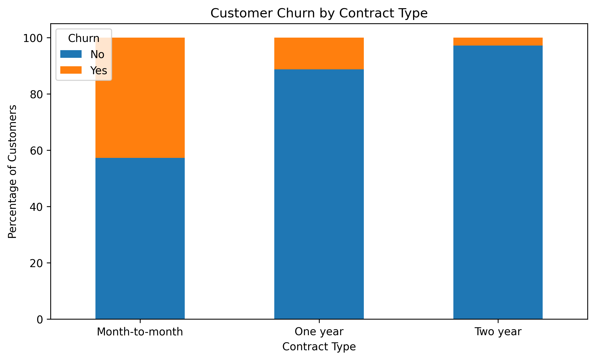
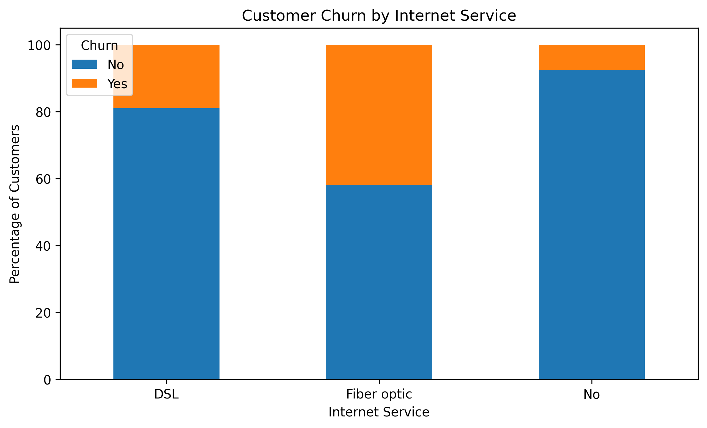
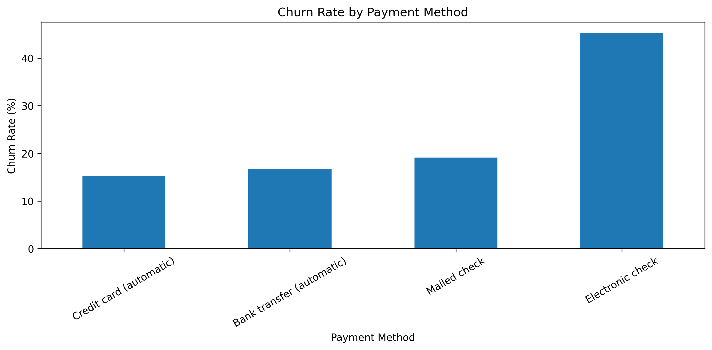
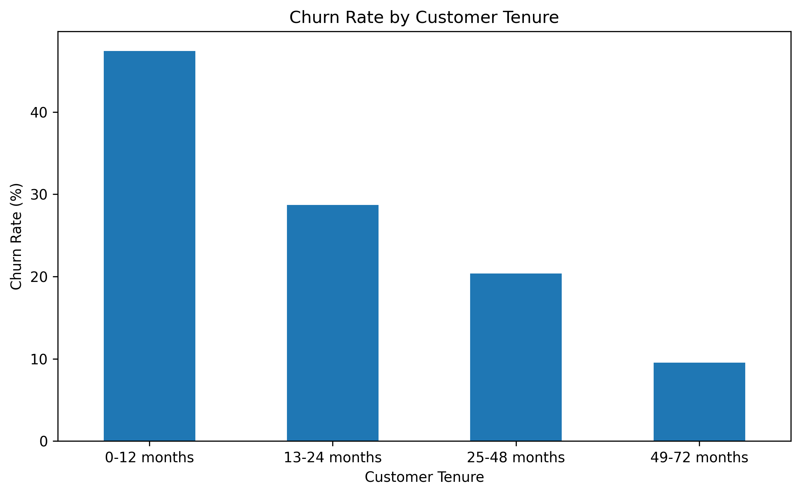
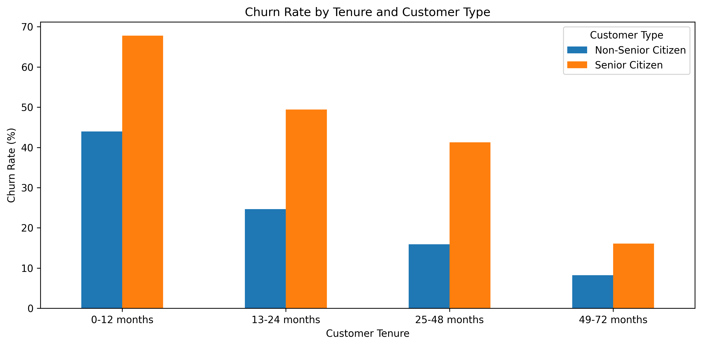
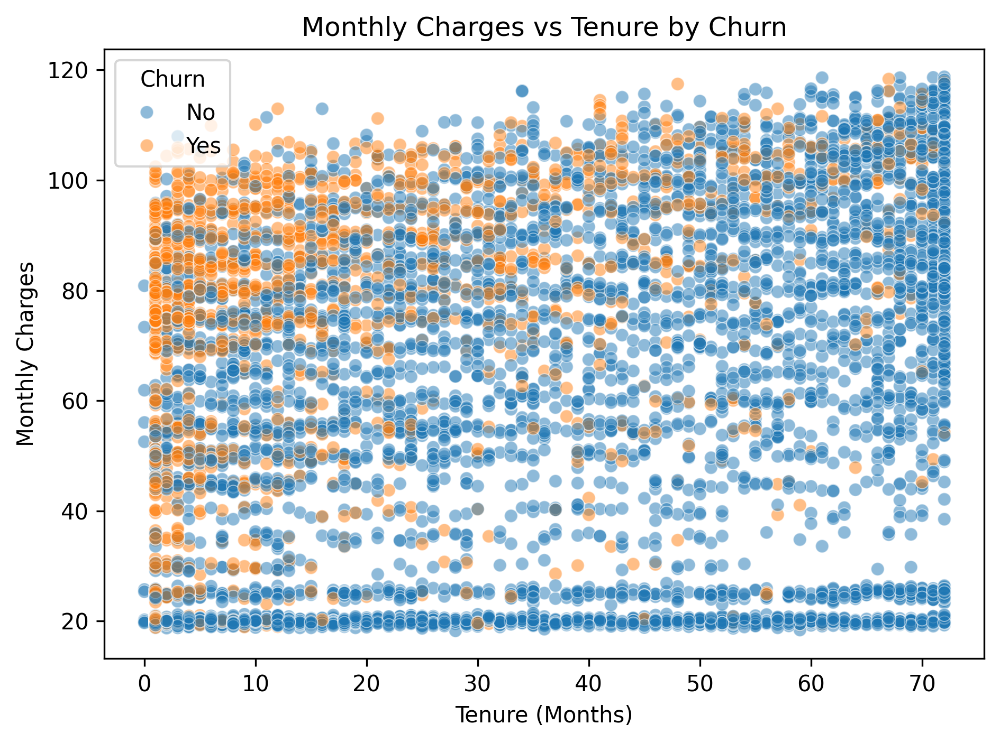

# Customer Churn Analysis

**Project Type:** Independent Data Analytics Project  
**Tools:** Python, Pandas, NumPy, Matplotlib, Seaborn, Jupyter Notebook  
**Dataset:** IBM Telco Customer Churn Dataset

## 1. Project Overview

Customer churn occurs when customers stop using a company's products or services. Understanding why customers leave helps businesses improve customer satisfaction, strengthen retention strategies, and reduce revenue loss.

This project analyzes customer data to identify patterns and characteristics associated with customer churn.

## 2. Business Problem

The business wants to understand:
- What types of customers are more likely to leave?
- Does contract type influence customer churn?
- Which internet services and payment methods are associated with higher churn?
- How do customer tenure and monthly charges relate to churn?
- What actions can the business take to improve customer retention?

## 3. Project Objectives

- Understand the overall customer churn rate.
- Identify high-risk customer segments.
- Analyze churn across contract types, internet services, and payment methods.
- Examine the relationship between tenure, monthly charges, and churn.
- Provide data-driven recommendations to improve customer retention.

## 4. Dataset Description

The IBM Telco Customer Churn dataset contains information about 7,043 customers and 21 original columns.

The dataset includes customer demographics, account information, services used, billing details, and churn status.

**Target variable:** Churn (Yes/No)

## 5. Data Cleaning and Preparation

The following preparation steps were performed:

- Loaded the dataset using Pandas.
- Inspected the dataset structure, columns, and data types.
- Converted `TotalCharges` from object to numeric format.
- Identified missing values created during numeric conversion.
- Created customer tenure groups for segmentation.
- Created customer type labels to compare senior and non-senior customers.

## 6. Exploratory Data Analysis

The analysis covered six visualizations:

1. **Churn by Contract Type:** Month-to-month customers showed the highest churn rate (approximately 42.71%), while two-year contract customers showed the lowest (approximately 2.83%).
    

2. **Churn by Internet Service:** Fiber optic customers showed the highest churn percentage among internet service categories.
    

3. **Churn by Payment Method:** Electronic check users had the highest churn percentage.
     

4. **Churn by Customer Tenure:** Customers with shorter tenure were more likely to churn.
     

5. **Tenure and Customer Type:** Senior citizens showed higher churn than non-senior customers. The first 12 months were the highest-churn tenure group for both customer types.
     

6. **Monthly Charges vs Tenure by Churn:** Churned customers were more concentrated at shorter tenure. Their average monthly charges were also higher.
    
## 7. Key Findings

- Total customers analyzed: 7,043.
- Customers who churned: 1,869.
- Customers who stayed: 5,174.
- Overall churn rate: approximately 26.54%.
- Month-to-month contracts had the highest churn rate.
- Customers with 0–12 months of tenure had a churn rate of approximately 47.44%.
- Customers with 49–72 months of tenure had a churn rate of approximately 9.51%.
- Average monthly charges were approximately $74.44 for churned customers and $61.27 for customers who stayed.

### High-Risk Customer Segment

A combined analysis of customers with:
- Month-to-month contracts
- Fiber optic internet service
- Electronic check payments

identified 1,307 customers, of whom 789 had churned.

**Churn rate for this segment: approximately 60.37%.**

This is substantially higher than the overall churn rate of 26.54%, making this segment important for further investigation and targeted retention efforts.

## 8. Business Recommendations

1. **Improve new-customer onboarding:** Provide guidance, regular follow-ups, and early-stage support during the first 12 months.

2. **Encourage longer-term contracts:** Offer suitable loyalty benefits and discounts to month-to-month customers.

3. **Improve fiber optic service quality:** Investigate customer complaints, service reliability, and pricing concerns.

4. **Simplify payment options:** Make payments easier and provide support for customers who struggle with electronic payments.

5. **Support senior customers:** Provide accessible interfaces, simple instructions, and dedicated customer assistance.

6. **Introduce targeted retention offers:** Use customer segments to provide relevant benefits rather than applying the same offer to everyone.

## 9. Performance Measurement

The business can monitor the following KPIs after implementing retention strategies:

- Customer churn rate
- Customer retention rate
- Monthly recurring revenue (MRR)
- Customer satisfaction (CSAT)
- Payment method adoption
- Retention rate of new customers

## 10. Conclusion

This analysis identified important customer segments associated with higher churn, particularly customers with short tenure, month-to-month contracts, fiber optic internet service, and electronic check payments.

The findings can help businesses design targeted retention strategies, improve customer experience, and make more informed decisions using data.

**Project Outcome:** An exploratory customer churn analysis with actionable business recommendations.
